# Mohana Sai Lingamaneni

 

[**About**](#about-me) &nbsp;·&nbsp; [**Featured Work**](#featured-work) &nbsp;·&nbsp; [**Toolkit**](#technical-toolkit) &nbsp;·&nbsp; [**Now**](#currently-building) &nbsp;·&nbsp; [**Connect**](#lets-connect)

## About Me

I'm an Information Systems student at **The University of Texas at Arlington** with a minor in **AI in Business**. I like projects where the work does not stop at cleaning a dataset—the result should explain an operational problem, support a decision, or become something people can actually use.

- Building **ShiftRepair**, a JavaFX shift-coverage recovery system with a four-person team
- Developing analytics and machine-learning projects with **Python, SQL, Power BI, Tableau, and Excel**
- Interested in **data analyst, business analyst, technology analyst, and operations analytics** opportunities
- Currently expanding into **APIs, cloud data workflows, and applied machine learning**

<table>
<tr>
<td align="center" width="25%"><strong>539K+</strong> flight records analyzed</td>
<td align="center" width="25%"><strong>425K+</strong> model training records</td>
<td align="center" width="25%"><strong>24K+</strong> job postings studied</td>
<td align="center" width="25%"><strong>4-person</strong> development team</td>
</tr>
</table>

**Live project pulse**

## Featured Work

<table>
<tr>
<td width="50%" valign="top">

### [ShiftRepair](https://github.com/Mohan-Lingamaneni/ShiftRepair)

A JavaFX system designed to help managers recover coverage when an employee calls out. It combines eligibility checks, scheduling constraints, ranked replacement options, timed offers, and recovery tracking in one workflow.

**My focus:** interface architecture, manager and employee workflows, GitHub integration, and project coordination

`Java` `JavaFX` `FXML` `CSS` `Maven`

[View the project →](https://github.com/Mohan-Lingamaneni/ShiftRepair)

</td>
<td width="50%" valign="top">

### OKC Thunder Shot Model

A classification case study estimating whether a basketball shot will be made. I prepared **425K+ training records**, engineered defender-pressure features, compared decision-tree configurations, and evaluated performance with log-loss and ROC AUC.

**Result:** selected an interpretable 63-leaf model that improved holdout log-loss

`Python` `pandas` `scikit-learn` `Machine Learning`

</td>
</tr>
</table>

### [Airline Operations Intelligence](https://github.com/Mohan-Lingamaneni/airline-operations-intelligence)

Analyzed **539K+ U.S. flight records** to study airline, airport, route, cancellation, and delay performance. The project includes a repeatable cleaning workflow, automated data-quality checks, a SQLite analytical layer, SQL KPI queries, and an interactive Power BI report in development.

**What I worked on:** operational KPIs, time-based delay patterns, route performance, data validation, and dashboard development

`Python` `pandas` `SQL` `SQLite` `Power BI`

  
  

[**Explore the full airline analysis →**](https://github.com/Mohan-Lingamaneni/airline-operations-intelligence)

---

### [Analytics Internship Radar](https://github.com/Mohan-Lingamaneni/analytics-internship-radar)

Analyzed **24K+ analyst job postings** to compare requested skills, salaries, employers, and locations. Python and pandas handle the preparation; Tableau turns the results into an interactive market-intelligence dashboard.

`Python` `pandas` `Tableau` `Git`

  

[**Explore the market analysis →**](https://github.com/Mohan-Lingamaneni/analytics-internship-radar)

---

### [Shipping Cost Reconciliation](https://github.com/Mohan-Lingamaneni/Shipping-Intelligence-mini-project)

Compared quoted and billed UPS and FedEx costs, calculated invoice variance, flagged possible overcharges, and summarized delivery performance by carrier.

`Python` `pandas` `Data Validation`

## Technical Toolkit

## Currently Building

| Project | Current focus | Next milestone |
|---|---|---|
| **ShiftRepair** | JavaFX manager and employee workflows | Complete the end-to-end recovery flow |
| **Airline Operations Intelligence** | Power BI report development | Publish the dashboard walkthrough |
| **Analytics stack** | APIs and applied ML | Build a source-to-dashboard pipeline |

## How I Work

  

---

### Let's Connect

I'm open to internship and early-career opportunities, project feedback, and conversations about analytics, business systems, and practical data work.

[LinkedIn](https://www.linkedin.com/in/mohana-sai-lingamaneni-/) · [Email](mailto:mohanasai.lingamaneni@gmail.com)

