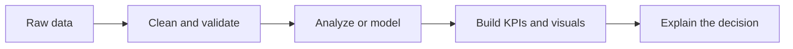

# Mohana Sai Lingamaneni

## About Me

I'm an Information Systems student at **The University of Texas at Arlington** with a minor in **AI in Business**. I like projects where the work does not stop at cleaning a dataset: the analysis should explain an operational problem, support a decision, or become a tool someone can actually use.

- Building **ShiftRepair**, a Java-based shift-coverage recovery system with a four-person team
- Developing analytics and machine-learning projects with **Python, SQL, Power BI, Tableau, and Excel**
- Interested in **data analyst, business analyst, technology analyst, and operations analytics** opportunities
- Currently expanding into **APIs, cloud data workflows, and applied machine learning**

## Featured Work

<table>
<tr>
<td width="50%" valign="top">

### [ShiftRepair](https://github.com/Mohan-Lingamaneni/ShiftRepair)

An automated shift-coverage recovery system that helps managers respond when an employee calls out. The workflow checks eligibility, considers scheduling and overtime constraints, ranks potential replacements, and tracks recovery progress through a JavaFX interface.

**My focus:** front-end workflow, dashboard experience, GitHub collaboration, integration support, and project coordination  
**Stack:** Java, JavaFX, Git, GitHub

Public team repository · Active development

</td>
<td width="50%" valign="top">

### OKC Thunder Shot Probability Model

Built a classification workflow to estimate whether a basketball shot would be made. I prepared **425K+ training records**, engineered defender-pressure features, compared decision-tree configurations, and evaluated performance using log-loss and ROC AUC.

**Result:** the selected 63-leaf model improved holdout log-loss while keeping the model interpretable  
**Stack:** Python, pandas, scikit-learn, machine learning

Analyst application case study

</td>
</tr>
</table>

### [Airline Operations Intelligence](https://github.com/Mohan-Lingamaneni/airline-operations-intelligence)

Analyzed **539K+ U.S. flight records** to study airline, airport, route, cancellation, and delay performance. The project includes a repeatable cleaning workflow, automated data-quality checks, a SQLite analytical layer, SQL KPI queries, and an in-progress Power BI dashboard.

**What I worked on:** operational KPIs, time-based delay analysis, route performance, data validation, and dashboard development  
**Stack:** Python, pandas, SQL, SQLite, Power BI

  

<strong>Explore more analytics projects</strong>

### [Analytics Internship Radar](https://github.com/Mohan-Lingamaneni/analytics-internship-radar)

Analyzed **24K+ analyst job postings** to compare requested skills, salaries, employers, and locations. Python and pandas handle preparation, while Tableau turns the results into an interactive market-intelligence dashboard.

  

### [Shipping Cost Reconciliation](https://github.com/Mohan-Lingamaneni/Shipping-Intelligence-mini-project)

Compared quoted and billed UPS and FedEx costs, calculated invoice variance, flagged possible overcharges, and summarized carrier delivery performance using Python and pandas.

## How I Approach a Project

## Technical Toolkit

**Analytics and programming**  

**Business intelligence and data**  

**Development workflow**  

## Currently Building

| Project | Current focus | Next milestone |
|---|---|---|
| **ShiftRepair** | JavaFX workflows and team integration | Complete end-to-end recovery flow |
| **Airline Operations Intelligence** | Power BI report development | Publish an interactive dashboard walkthrough |
| **Analytics stack** | APIs and cloud fundamentals | Build a source-to-dashboard pipeline |

## Let's Connect

I'm open to internship and early-career opportunities, project feedback, and conversations about analytics, business systems, and practical data work.

**Email:** [mohanasai.lingamaneni@gmail.com](mailto:mohanasai.lingamaneni@gmail.com)  
**LinkedIn:** [linkedin.com/in/mohana-sai-lingamaneni-](https://www.linkedin.com/in/mohana-sai-lingamaneni-/)
